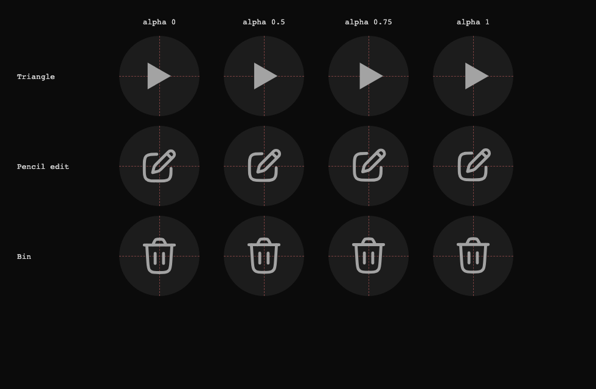

# Optical alignment

**Rule:** centre an icon by where its shape weighs, not by its box.

Equal padding centres the box an icon is drawn in. The eye centres the
*shape*. Icons whose shape is lopsided (a pencil poking out of a square, a bin
with a wide lid, a play triangle) look off-centre in a perfectly centred box.
Measure where the shape weighs, then move the icon by the difference.

## The formula

Inputs: the SVG (viewBox `V`, its paths, its stroke width), the size it is
drawn at `s`, the box it sits in `B`, and the smallest step worth moving
`step` (0.25px is visible on 2× screens).

1. **Silhouette.** Fill every shape, keep the strokes, draw at high
   resolution (480px). Each pixel's opacity is its weight `w(x, y)`.
   (Outline strokes alone are too thin to carry weight; the eye reads the
   shape they enclose.)
2. **Two centres**, in viewBox units:
   - box centre `Cb`: the middle of the drawn ink's bounds
   - mass centre `Cm = Σ w·(x, y) / Σ w`
3. **Perceived centre.** Pure mass over-corrects strong shapes, the box
   under-corrects them. Blend:

   ```
   C_eye = α·Cm + (1 − α)·Cb          α = 0.7 by default (see Calibration)
   ```
4. **Offset at the drawn size, and the nudge.**

   ```
   Δ     = (C_eye − V/2) · s / V
   nudge = −round(Δ / step) · step
   ```
5. **Padding** (the same thing as `translate(nudge)` on the icon):

   ```
   p      = (B − s) / 2
   left   = p + nudge.x      right  = p − nudge.x
   top    = p + nudge.y      bottom = p − nudge.y
   ```
6. **Optical size** (optional, for a set). A square looks bigger than a
   circle of the same width. With `A` the share of the viewBox an icon's
   silhouette covers and `A_ref` the share you want them all to read at:

   ```
   s_opt = s · √(A_ref / A)
   ```

## Calibration (2026-11-20)

How icon systems place their own play triangle, against its mass, gives the
`α` each one chose: `α = (Cb − V/2) / (Cb − Cm)` on the x axis.

| Icon system | box centre x | mass centre x | α it chose |
| --- | --- | --- | --- |
| Material `play_arrow` | 13.50 | 11.67 | **0.82** |
| Tabler `player-play-filled` | 13.50 | 11.31 | **0.68** |
| Lucide `play` | 13.00 | 10.99 | **0.50** |
| Hugeicons `play` | 12.00 | 10.77 | 0 (box-centred, no correction) |

The systems that correct sit between 0.5 and 0.82, mean 0.67. **Default
α = 0.7.** `calibration/calibration.png` shows a triangle, the pencil and the
bin at α 0 / 0.5 / 0.75 / 1 to judge by eye; move α if your eye disagrees.



## Worked example: Hugeicons edit and bin, 14px in a 28px button

Measured (24-unit grid): pencil-edit box 12.00, 12.00, mass **11.32, 12.68**;
bin box 12.00, 12.00, mass **12.00, 12.32**.

| α | edit nudge (x, y) | bin nudge (x, y) |
| --- | --- | --- |
| 0.5 | +0.25, −0.25 | 0, 0 |
| 0.7 | +0.25, −0.25 | 0, −0.25 |
| 0.82 | +0.25, −0.25 | 0, −0.25 |
| 1 | **+0.50, −0.50** | **0, −0.25** |

Shipped in the billing payment-methods dialog: **α ≈ 1** (edit +0.5, −0.5;
bin 0, −0.25), chosen by eye at that size. At 14px the icons are small enough
that the stronger nudge read better; at larger sizes start from 0.7.

## Run it

```bash
# measure icons and get nudges + paddings
node optical-center.mjs icon.svg other.svg --size 14 --box 28 --alpha 0.7

# re-run the calibration and the sheet
node optical-center.mjs --calibrate --out ./calibration
```

Needs Playwright (`npm i -D playwright`) and Chromium
(`npx playwright install chromium`), or `CHROMIUM_PATH=/path/to/chrome`.
Output per icon: `box`, `mass`, `area`, `eye`, `nudge`, `padding`, `scale`.

## Limits

- It weighs shape in two dimensions only. Direction (an arrow that "points",
  a chevron) can pull the eye further than its mass; check those by eye.
- Filling open paths closes them with a straight chord; for very open
  shapes (a lone hook, a bracket) the mass is approximate.
- Round the nudge to a step the screen can show; sub-quarter-pixel moves
  are noise.
