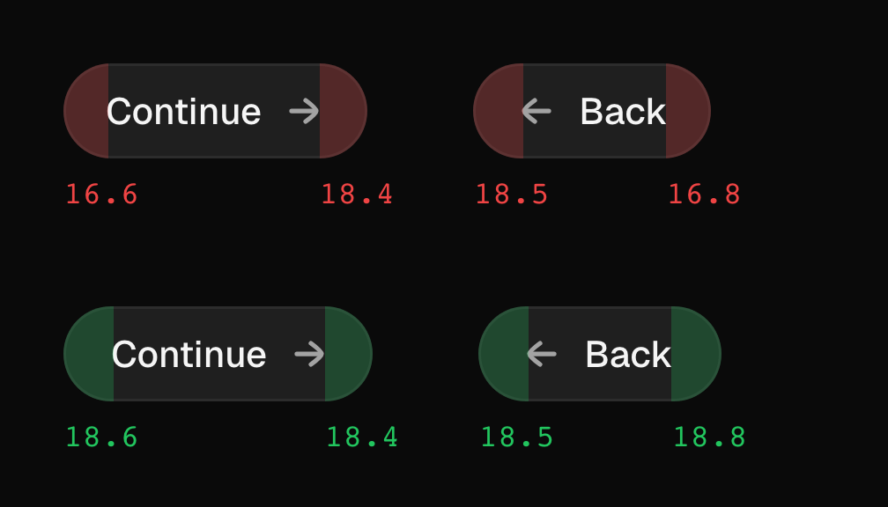

# Button icon padding

**Rule:** with an icon in a button, give the text side about 2px more
padding than the icon side.



Top row: `padding-inline: 16px`. Bottom row: the text side gets 2px extra.
Each side is shaded from the button's edge to the ink.

## The problem

A button with a label and an arrow, 16px of padding on both sides:

```css
.button {
  display: inline-flex;
  align-items: center;
  gap: 8px;
  padding-inline: 16px;
}
```

The padding is equal, but the button looks off: the arrow side looks
wider. Two kinds of air add up:

- **The icon's box has air inside it.** Icon sets draw on a 24-unit grid
  and leave room around the drawing. Hugeicons' `ArrowRight02` draws from
  x = 5 to x = 19; with its stroke, the ink starts about **2.5px** inside
  the 16px box on each side.
- **Letters have it too, but less.** The space before a "C" or after a
  "k" (the side bearing) is about **0.6px** at 14px.

So the icon side shows about 16 + 2.5, and the text side about 16 + 0.6.
Measured on a 14px Geist button with a 16px Hugeicons arrow:

| | text side | icon side |
| --- | --- | --- |
| `padding-inline: 16px` | 16.6 | 18.4 |

A 1.8px difference on a 36px-tall button is enough to see.

## The fix

Give the text side the difference. The icon side keeps its padding:

```diff
 .button {
-  padding-inline: 16px;
+  padding-inline: 18px 16px;   /* text first, icon last */
 }
+.button--icon-start {
+  padding-inline: 16px 18px;   /* icon first, text last */
+}
```

Tailwind: `ps-[18px] pe-4` for a trailing icon, `ps-4 pe-[18px]` for a
leading one.

Why add to the text side instead of trimming the icon side: the button
grows by 2px instead of the icon getting closer to the edge, and the
icon side keeps the padding the rest of the design system uses.

## Steps

1. **Measure first:** `node ink-gaps.mjs <url> --select "button"`. It
   prints each button's gaps to the ink and says which side is short.
2. **Add the difference to the text side,** rounded to a whole or half
   px. For arrows at 16px in a 14px label, that's 2px.
3. **Mirror it** for icons at the start.
4. **Re-run** until every button passes (sides within 0.5px), and leave a
   comment beside the padding saying it's optical.

## Numbers

Measured with `ink-gaps.mjs` on [example.html](example.html) (14px Geist
medium, 16px Hugeicons arrows, stroke 1.75):

| | padding | gaps to the ink | difference |
| --- | --- | --- | --- |
| Continue → | 16 / 16 | 16.6 / 18.4 | 1.8 · FAIL |
| Continue → | **18** / 16 | 18.6 / 18.4 | 0.2 · PASS |
| ← Back | 16 / 16 | 18.5 / 16.8 | 1.8 · FAIL |
| ← Back | 16 / **18** | 18.5 / 18.8 | 0.2 · PASS |

**2px is for arrows.** The extra is the icon's air minus the letter's:

- Icons that fill more of their box (a plus drawn from 4 to 20) have
  about 1.8px of air, so they need about 1px extra, not 2.
- Words that start or end on a straight stem (L, d, k, b) have about
  1.2px of side bearing, so they need a little less. In the original
  test, "Download" and "Learn more" were still 0.6–0.7px out at +2px;
  "Save file" and "See more" (rounder letters) landed within 0.3px.

Measure your own icons and labels rather than copying the number.

## How to check

```bash
npm i -D playwright && npx playwright install chromium
node ink-gaps.mjs http://localhost:3000 --select "button" --shot gaps.png
```

| Option | Default | |
| --- | --- | --- |
| `--select` | `button` | what to measure |
| `--axis` | `x` | `x` left/right, `y` top/bottom, `both` |
| `--tolerance` | 0.5 | allowed difference in px |
| `--shot` | none | save a picture with each side shaded to the ink |
| `--scale` | 2 | device scale for the picture |
| `--width` / `--height` | 1280 / 800 | viewport |

Text ink comes from where each glyph sits plus the font's own metrics;
icon ink from each SVG shape's box plus half its stroke. Try it on the
example, from the `notes-optical-spacing` folder:
`node ink-gaps.mjs file://$PWD/button-icon-padding/example.html`.

## When not to

- **Icon-only buttons.** No text side; centre the icon with
  [`notes-optical-alignment`](../../notes-optical-alignment/) instead.
- **The icon has a background** (a filled circle, a badge). Its box is the
  ink, so equal padding is already right; the script counts filled
  children as solid.
- **Fixed-width buttons** with the content centred. Padding isn't what
  places the content; nudge the content with a margin on the icon instead.
