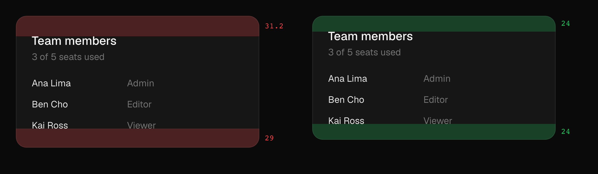

# Card text trim

**Rule:** a card with text at its edges should trim that text's line
air, so its padding is the padding you see:
`text-box: trim-both cap alphabetic`.



Left: `padding: 24px`. Right: the same card with `text-box: trim-both cap
alphabetic`. Each side is shaded from the card's edge to the ink.

## The problem

A card with 24px of padding: a title, a line of sub text and a list.

```css
.card { padding: 24px; }
.card h3 { font-size: 18px; line-height: 28px; }
.card li { font-size: 14px; line-height: 20px; }
```

Every line of text is taller than its letters. The line box adds
half-leading above and below, and the font reserves room above its
capitals (for accents and tall letters) and below its baseline (for
descenders). So the first line's capitals sit below the padding, and the
last line's baseline sits above it.

Measured in Geist, on the card below:

| | air |
| --- | --- |
| Above the capitals of an 18px title on a 28px line | 7.2px |
| Below the baseline of 14px text on a 20px line | 5.0px |

On the card above, 24px of padding reads as **31.2 at the top and 29 at
the bottom**: bigger than 24 on both sides, and not the same.

It's worst when only one edge is text. A card with a heading at the top
and a button at the bottom reads as **31.2 / 24**: the button's edge has
no air, the heading has 7.2px, and the content looks like it slid down.

## The fix

```diff
 .card {
   padding: 24px;
+  text-box: trim-both cap alphabetic;
 }
```

`text-box` trims the first line's top down to the capitals (`cap`) and the
last line's bottom up to the baseline (`alphabetic`). Nothing in between
changes: the gaps between the title, the sub text and the list stay as
they were.

Tailwind: `[text-box:trim-both_cap_alphabetic]`.

**Keep the card's inside in block flow.** The trim reaches the first and
last lines through ordinary blocks (a `div`, a `ul`, an `li`). If the card
is a flex or grid column, put `text-box` on the first and last text
elements instead:

```css
.card > :first-child { text-box: trim-start cap alphabetic; }
.card > :last-child  { text-box: trim-end cap alphabetic; }
```

**Support:** Chrome 133+ and Safari 18.2+; check Firefox on caniuse.
Where it isn't supported, nothing breaks: the card keeps its line air, as
before. To match everywhere, measure the air with `ink-gaps.mjs` and take
it off the padding by hand (`padding-top: 17px` under an 18px / 28px
heading), at the cost of numbers that change with the font.

## Steps

1. **Measure:** `node ink-gaps.mjs <url> --select ".card" --axis y`. It
   prints the gaps to the ink, and how much line air sits over the
   padding.
2. **Add `text-box: trim-both cap alphabetic`** to the card.
3. **Check the inside is block flow,** or move the trim to the first and
   last children.
4. **Re-run** until top and bottom pass (within 0.5px) and match the
   padding.
5. **Look at descenders.** A last line with g, j, p, q or y now dips into
   the bottom padding. That's how type sits on a baseline and reads
   right; but leave the padding at least as big as the descender.

## Numbers

Measured with `ink-gaps.mjs` on [example.html](example.html) and
[example-button.html](example-button.html) (Geist, 24px padding):

| Card | without trim | with trim |
| --- | --- | --- |
| Title, sub text, list | 31.2 / 29.0 · FAIL | 24.0 / 24.0 · PASS |
| Title, sub text, button | 31.2 / 24.0 · FAIL | 24.0 / 24.0 · PASS |

## How to check

```bash
npm i -D playwright && npx playwright install chromium
node ../ink-gaps.mjs http://localhost:3000 --select ".card" --axis y --shot gaps.png
```

Top / bottom compares the first line's cap top and the last line's
baseline with the card's edges. Children with a fill, a border or a
shadow (a button, an image, a badge) count as solid ink, so a card that
ends in a button measures to the button's edge. Options are in the
[button note](../button-icon-padding/README.md#how-to-check).

## When not to

- **Images or filled blocks at both edges.** There's no line air to trim;
  equal padding is already right.
- **Text that has to line up with something beside it,** like a label
  next to an input whose box is untrimmed. Trim both or neither.
