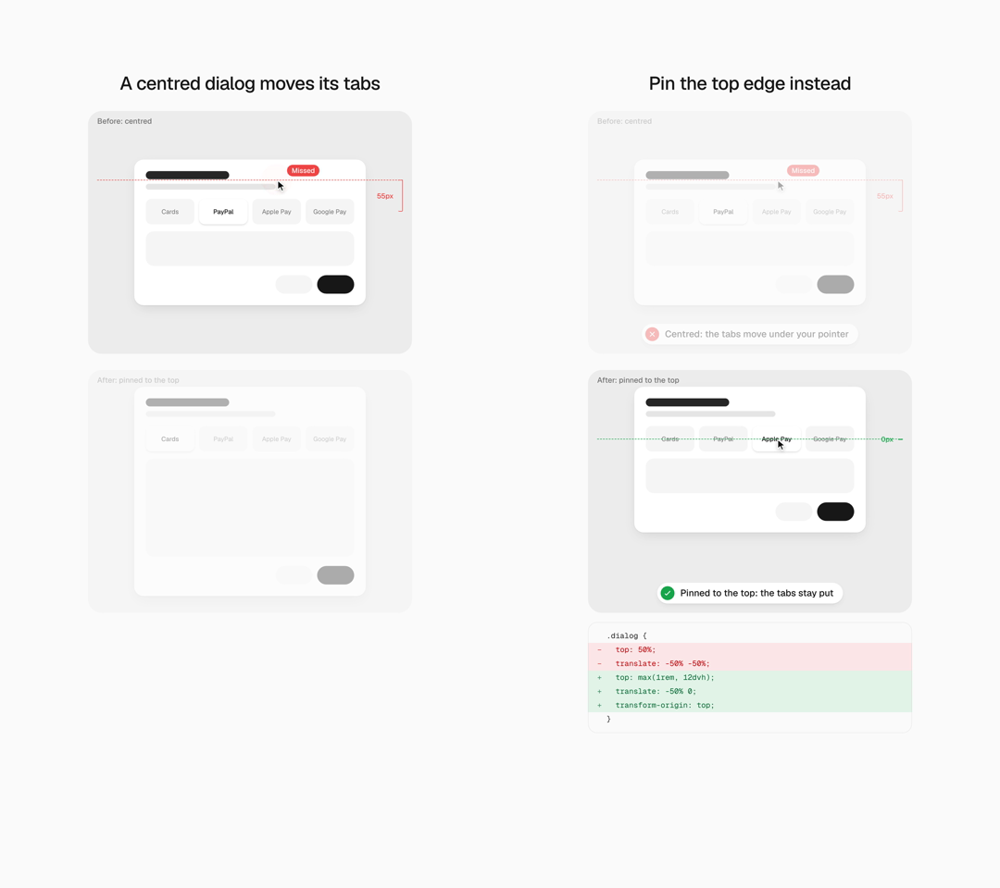

# Tab anchor

**Rule:** pin the edge your controls sit on; let only the far edge move.



[Watch the 15s video](media/tab-anchor.mp4) (9:16).

## The problem

A dialog has tabs (Cards, PayPal, Apple Pay, Google Pay) and each tab shows
content of a different height. The dialog is centred on the screen:

```css
.dialog {
  position: fixed;
  left: 50%;
  top: 50%;
  translate: -50% -50%;
}
```

Centred means the *middle* stays put. Click PayPal, the content gets
shorter by `Δh`, and the dialog re-centres: its top drops by `Δh / 2`, and
the tab row drops with it. The pointer is still where PayPal was. Click
again for Apple Pay and you hit whatever slid under the pointer, or the gap
above the dialog.

The more the heights differ, the worse it gets. In the dialog this note
comes from, Cards ↔ a wallet changed the tray by about 350px, so the tabs
slid about **175px** under the pointer.

## The fix

Pin the top edge. The top never moves, so the tabs never move; only the
bottom edge follows the content.

```diff
 .dialog {
-  top: 50%;
-  translate: -50% -50%;
+  top: max(1rem, 12dvh);
+  translate: -50% 0;
+  transform-origin: top;
+  max-height: calc(100dvh - max(1rem, 12dvh) - 1rem);
 }
```

- `max(1rem, 12dvh)`: about an eighth of the way down, never closer than
  1rem to the edge on short screens. The tallest state then sits roughly
  where a centred one would.
- `transform-origin: top`: the open animation's scale grows from the pinned
  edge instead of the middle.
- `max-height` takes the new top (and 1rem at the bottom) off the screen
  height, so a tall state scrolls inside instead of running off the screen.

Tailwind (what shipped):

```
fixed left-1/2 top-[max(1rem,12dvh)] -translate-x-1/2 origin-top
max-h-[calc(100dvh-max(1rem,12dvh)-1rem)] overflow-y-auto
```

## Steps

1. **Find the anchor.** Look for boxes positioned around their centre:
   `top: 50%` with `translate: -50% -50%` (Tailwind `top-1/2 -translate-y-1/2`),
   `align-items: center` / `place-items: center` on a full-screen wrapper,
   `margin: auto` in a fixed flex or grid overlay. If the box holds tabs (or
   any control clicked over and over) and its content changes height, it
   needs pinning.
2. **Pin the top edge** as above. For a centring wrapper instead of a
   positioned box: `align-items: start` and `padding-top: max(1rem, 12dvh)`.
3. **Fix what pinning touches:** `max-height` minus the new top,
   `transform-origin: top` for the open animation, and a top offset where
   the tallest state still looks centred (`12dvh` suits most dialogs).
4. **Switch panels at once**, without a cross-fade (see below).
5. **Check it** with `tab-drift.mjs` (see [How to check](#how-to-check)) and
   leave a comment beside the CSS saying why the box is pinned, so nobody
   centres it again.

## While you're there: no cross-fade on tabs

The same dialog cross-faded its panels with a blur. Mid-way, two
half-faded panels of filled cards let the tray behind show through, which
read as the background flickering. People click tabs back and forth to
compare, so the switch should be instant: swap the panel at once and let
the height change carry the motion.

## Numbers

| | top of the box | tab row moves per switch |
| --- | --- | --- |
| Centred | `(viewport − h) / 2` | `Δh / 2` |
| Pinned to the top | `max(1rem, 12dvh)` | **0** |

Measured with `tab-drift.mjs` on a test dialog (panels 320 / 110 / 180px):

| | worst drift | result |
| --- | --- | --- |
| Centred | 105px (= 210 / 2) | FAIL |
| Pinned | 0px | PASS |

## How to check

```bash
npm i -D playwright && npx playwright install chromium
node tab-drift.mjs http://localhost:3000/settings/billing \
  --open "button:has-text('Payment methods')"
```

It opens the page, clicks `--open`, then clicks every tab inside the open
`[role=dialog]` and goes back to the first. Every frame of each switch is
sampled, so drift during a height animation counts too. It prints a table
(box height, row top, worst drift) and exits 1 if the row moved more than
0.5px. If the box never changed height, it says the run proves nothing.

| Option | Default | |
| --- | --- | --- |
| `--open` | none | click this first to open the dialog |
| `--scope` | open `[role=dialog]`, else `body` | where to find the tabs |
| `--tabs` | `[role=tab]` | what to click |
| `--watch` | `[role=tablist]` | what must stay put |
| `--width` / `--height` | 1280 / 800 | viewport |
| `--tolerance` | 0.5 | allowed drift in px |

Run it at a short viewport too (`--height 640`): that is where `max-height`
mistakes show.

## When not to

- **The height never changes.** A centred box that keeps its size can stay
  centred; nothing moves.
- **The controls are at the bottom.** Pin the edge the controls are on. A
  bottom sheet with its actions at the bottom is already pinned the right
  way.
- **It's not just dialogs.** Popovers placed around a trigger's middle,
  cards in a centred row, a stepper whose footer re-centres: wherever
  people click the same control again, keep its edge still.
